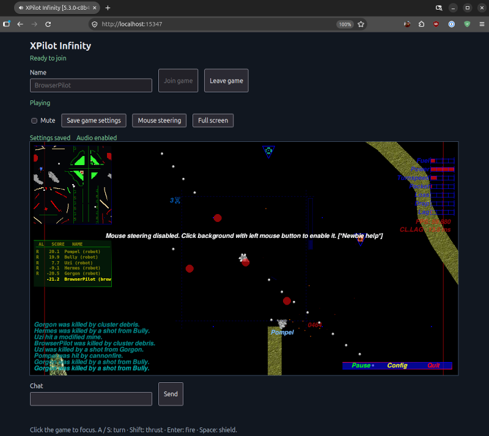

# XPilot Infinity

1991 年から続くマルチプレイヤー・オンライン・スペースアクション。


Copyright © 1991-2005 by Bjørn Stabell, Ken Ronny Schouten, Bert Gijsbers,
Dick Balaska, Uoti Urpala, Juha Lindström, Kristian Söderblom and Erik
Andersson.

詳細については [COPYING](COPYING) を参照してください。すべての文書、ソースコード、
および COPYING ファイルを含めずに、このプロジェクトを配布することはできません。

> XPilot Infinity は XPilot NG から改名されました。
> XPilot Infinity の開発と配布は [xpilot-infinity リポジトリ](https://github.com/kekyo/xpilot-infinity/) で行われています。

[](https://www.repostatus.org/#active)

---

[(English language is here)](./README.md)

## XPilot Infinity とは？

[www.xpilot.org より](https://www.xpilot.org/about/):

XPilot はマルチプレイヤー対応の 2D スペースゲームです。Atari のアーケードゲーム
Asteroids や Gravitar、家庭用コンピューターゲームの Thrust（Commodore 64）や
Gravity Force（Commodore Amiga）といった名作から一部の要素を取り入れていますが、
XPilot には独自の新しい要素も数多くあります。


主な特徴:

- 完全なクライアント／サーバー方式のゲームで、すべてのプレイヤーに最適な速度を提供します。
- 世界各地でゲームをホストしているサーバーの最新情報を提供するメタサーバーがあります。
- 世界規模のレーティングサーバー網により、世界中のパイロットと腕を競い、世界ランキングを上げられます。
- 「リアルな物理演算」を採用しています。爆発の破片やエンジンから出る火花も、接触すれば機体に影響します。このため、エンジンの推力や爆発の衝撃波で相手を壁へ追い込み、倒すこともできます。
- 機体形状とマップを編集する専用エディターがあります。
- ゲームの目的やプレイ内容は、コマンドライン、専用のオプションファイル、またはマップファイルで指定する多数のオプションによって調整できます。ゲームモードの例:
  - クラシックなドッグファイト: 武器は銃のみで、操縦技術と戦術が勝敗を分けます
  - チーム戦: 仲間と協力し、他チームの宝物を奪い（Thrust のように、ひもにつながれたボールを運びます）、厳重に守られた標的を破壊します
  - 全面核戦争: 20 種類を超える武器・防御システムから慎重に装備を選び、生き残りながら敵を殲滅します
  - レース: 対戦相手より先に危険なコースを走破します
- 重力を調整できます。ワールド内に特殊な引力源や斥力源を配置したり、全体の重力をさまざまな方法で変更したりできます。
- 大砲や、個性的で執念深いロボット戦闘機が行く手を阻みます。
- エネルギーに注意し、手遅れになる前に燃料ステーションへ「ドッキング」して補給しましょう。
- 自分の本拠地を守ることも、他人の本拠地を襲って奪うこともできます。
- アフターバーナー、クローキング装置、センサー、転送装置、追加砲、機雷、爆弾、ロケット、スマートミサイル、魚雷（核弾頭を含む）、ECM、レーザー、追加タンク、オートパイロットなど、15 種類を超える防御・武器システムを機体に装備できます。

## インストールとドキュメント

[xpilot-infinity リポジトリ](https://github.com/kekyo/xpilot-infinity/releases/) でバイナリパッケージを入手できます。

対応パッケージの一覧は次のとおりです。

| ディストリビューション | リリース | アーキテクチャ |
| :--- | :--- | :--- |
| Debian | bookworm | amd64, i386, arm64, armhf |
| Debian | trixie | amd64, i386, arm64, armhf, riscv64 |
| Ubuntu | 22.04 | amd64, arm64 |
| Ubuntu | 24.04 | amd64, arm64 |
| Ubuntu | 26.04 | amd64, arm64 |
| Windows | - | x86（32 ビット）, x86_64（64 ビット） |
| Node.js / npm | 24.19.0以降の24系、または26.4.0以降 | Node.js の対応プラットフォーム |

- 動作環境: SDL3、OpenGL 3.3、OpenAL（サウンド）

Debian および Ubuntu パッケージは、XDG 互換のアプリケーションメニューに
**XPilot Infinity** を追加します。ランチャーはパッケージ付属のアプリケーション
アイコンを使用し、追加の引数なしで SDL サーバーブラウザーを開きます。

### Node.js/ブラウザ環境でのプレイ

ネイティブクライアントに加えて、ブラウザでもプレイできます。
[Node.js版](xpilot-server/README.md)はWASMサーバーとブラウザクライアントを同梱しています。
Node.js 24.19.0以降の24系、または26.4.0以降で実行できます。

グローバルにインストールして起動するには、次のコマンドを実行します。

```sh
npm install -g xpilot-infinity
xpilot-infinity
```

または、npx で起動できます。

```sh
npx xpilot-infinity
```

[`http://localhost:15347/`](http://localhost:15347/) を開くと参加できます。



ネイティブクライアントは UDP 15345・TCP 15346・WebSocket 15347 に接続できます。
終了は Ctrl+C、保存先は既定で `~/.xpilot-infinity` です。
`--data-dir` で変更できます。実行時にコンパイラーや別のネイティブサーバーは必要ありません。

参加手順、基本操作、自分でサーバーを起動する方法は [ブラウザでプレイする](docs/ja/browser.md) を参照してください。

### Dockerコンテナでのプレイ

DockerまたはPodmanで、サーバーとブラウザクライアントを同梱したイメージを起動できます。
対応CPUはLinuxのamd64とarm64です。

```sh
docker run --rm -p 15347:15347/tcp docker.io/kekyo/xpilot-infinity:latest
```

`http://localhost:15347/`を開き、名前を入力して`Join game`を押します。終了するにはCtrl+Cを押してください。
Podmanを使う場合は、コマンドの`docker`を`podman`に置き換えます。

この例では、ブラウザ配信とWebSocketのポートだけを公開します。
データの保存、TCP／UDPの公開、イメージのビルドについては、後半の[Podmanでサーバーを実行する](#podman-でサーバーを実行する)を参照してください。

### Windows へのインストール

Windows リリースでは、各アーキテクチャ向けに NSIS インストーラーと ZIP
アーカイブの両方を提供しています。通常のインストールでは、対応する
`xpilot-infinity-<version>-windows-<architecture>-setup.exe` を実行してください。
クライアント、サーバー、ゲームデータ、スタートメニューのショートカットが
インストールされます。スタートメニューから **XPilot Infinity** を選択すると、
SDL サーバーブラウザーが開きます。

ZIP アーカイブはポータブル版です。書き込み可能な任意のディレクトリに展開し、
`xpilot-infinity-sdl.exe` を直接実行してください。ポータブル版を使用する場合、
NSIS パッケージをインストールする必要はありません。

ソースコードからインストールする手順は [INSTALL](INSTALL) にあります。

## ゲームのクイックスタート

XPilot はサーバープログラムとクライアントプログラムで構成されています。
1 台のサーバーに複数のクライアントが接続するマルチプレイヤーゲームです。

最初にサーバーを起動します。

```bash
xpilot-infinity-server -noQuit
```

`-noQuit` は、すべてのクライアントが切断した後もサーバーを実行し続けるための
パラメーターです。同じサーバープロセスを引き続き利用できます。
サーバーを終了するには、Ctrl-C などを押すだけです。

サーバーの実行中に次のコマンドを入力すると、ローカルネットワークと
メタサーバーの両方から取得したサーバー一覧が表示されます。

```bash
xpilot-infinity-sdl
```


> メタサーバーとは、全世界で公開されているXPilotのサーバー一覧を管理しているサーバーです。 xpilot.org によって運営されています。

サーバーへ接続してゲームを開始できます。

次のような URL を指定して、サーバーへ直接接続することもできます。

```bash
xpilot-infinity-sdl udp://localhost
```

`udp://` URL が示すとおり、この例では UDP プロトコルを使用します（UDPはデフォルトで、XPilot NGの最後のバージョンと互換性があります）。
TCP (`tcp://`) または WebSocket (`ws://`) も使用できます。

URL を指定せずに SDL クライアントを起動すると、メタサーバーへの問い合わせと、ローカルネットワーク上での 1 回の UDP 探索が行われます。サーバーブラウザーは両方の結果を統合して取得元を表示し、LAN サーバーを先頭に配置します。

サーバーは既定でUDPプロトコルで接続を受け付けるため、この手順で自動的にリストアップされるはずです。
`-localDiscovery no` を指定すると LAN への問い合わせを無効にできます。

ほかにも多くの機能がありますが、ここですべてを紹介することはできません。

XPilot Infinity のドキュメントは、まだ十分に整備されていません。詳しくは
[`doc/man`](doc/man) ディレクトリ内のマニュアルを参照してください。

---

## XPilot NG と XPilot Infinity の違い

XPilot Infinity は、現代の環境でも XPilot が快適に動作することを目標としています。
NG バージョン 4.7.3 からの主な変更点は次のとおりです。

- TCP と WebSocket のネットワークプロトコルを追加しました。これにより、ルーターやファイアウォールを通過しやすくなる場合があります。
- 現代的なグラフィックス環境へ更新しました。SDL3 へ移行し、OpenGL 3.3 コアプロファイルとOpenGL ESに対応しています。
- ウェブ環境でも動作するように移植しました。
  サーバーはNode.js上で主にWASM (WebAssembly)で動作し、クライアント側もOpenGL ESベースとWASMベースで、特別なインストール作業不要で、現代のブラウザ環境ですぐに遊べます。
- 内部構造を一部リファクタリングしました。
  これは、上記の変更を実現するためにも不可欠でした。
  ただし、バージョン 4.7.3 との UDP プロトコル互換性は維持しています。
- ユーザー名で TTF による多言語フォント表示に対応しました。
  現時点では、[Noto Sans Mono とそのファミリー](https://fonts.google.com/noto/specimen/Noto+Sans+Mono)をインストールしてください。
- サウンドエンジンを有効にしました。
- Windows バイナリを MinGW ツールチェーンでビルドできるように変更しました。
- 複数のアーキテクチャ向けに Debian パッケージ（*.deb）をビルドできるようになりました（Podman を使用）。

## ネットワークトランスポート

一つのサーバーで UDP、TCP、WebSocket のプレイヤーを同じゲームへ受け入れられます。

```console
xpilot-infinity-server -listen udp:15345,tcp:15346,websocket:15347 -map ndh.xp2
xpilot-infinity-sdl -join udp://server.example:15345
xpilot-infinity-sdl -join tcp://server.example:15346
xpilot-infinity-sdl -join ws://server.example:15347
```

`listen` には各方式を一つずつ、任意の空でない組合せで指定できます。ポート番号は
1〜65535 です。`ws` は `websocket` の別名で、方式名の大文字小文字は区別しません。
TCP と WebSocket は別ポートが必要です。`+reportMeta` でメタサーバーへの告知を
無効にした場合は、UDP とストリーム方式で同じポート番号を使用できます。告知を
有効にする場合は全方式で異なる番号を指定します。サーバー一覧には待受ごとに
同じプレイヤー・マップ情報を持つ項目が表示されます。人数、名前、IP ごとの制限は
すべての方式で共有します。

サーバーの defaults ファイルでも `listen: udp:15345,tcp:15346,websocket:15347`
と指定できます。`contactPort`／`port`、`contactTransport`、`gameTransport`、
トランスポートの短縮指定との併用はできません。設定ファイル内の明示指定も対象です。
待受の変更には再起動が必要です。無効な設定や使用できない待受ポートが一つでも
あれば起動に失敗します。`listen` を省略すると以下の単一待受設定を使い、既定では
UDP の 15345 番で待ち受けます。

上の例では、ファイアウォールやコンテナで UDP の 15345 番と TCP の 15346・15347 番を
公開します。UDP のゲーム通信には、さらにサーバーの `clientPortStart`／`clientPortEnd`
の範囲でプレイヤーごとのポートが必要です。固定ポートの TCP／WebSocket セッションは
入場とゲーム通信に同じ待受ポートを使います。メタサーバーへの告知は TCP／WebSocket
も含む各待受と同じ番号の UDP ポートから送信します。再接続では元の方式とポートを
使い、別方式への移行は行いません。

接続確認／ロビー接続とゲームプレイ接続は既定で UDP を使用し、それぞれを
個別に選択できます。両方で TCP を使用するには、次の例のようにサーバーと
クライアントの設定を一致させて起動します。

```console
xpilot-infinity-server -transport tcp [options]
xpilot-infinity-sdl -join tcp://server.example
```

両方で WebSocket を使用することもできます。

```console
xpilot-infinity-server -websocket [options]
xpilot-infinity-sdl -join ws://server.example
```

サーバーの短縮オプション `-tcp`、`-udp`、`-websocket`、および
`-transport udp|tcp|websocket` は、接続確認／ロビーとゲームプレイの両方に
同じトランスポートを指定します。コマンドラインのトランスポートオプションは
左から右へ適用されるため、後に指定した `contactTransport` または
`gameTransport` オプションを使って UDP/TCP の分離構成にすることもできます。
WebSocket は両方のトランスポートに指定する必要があります。

クライアントの直接接続先には、`HOST`、`ws://HOST[:PORT]`、
`tcp://HOST[:PORT]`、または `udp://HOST[:PORT]` を指定できます。
スキーム付きの接続先を指定すると、接続確認／ロビーとゲームプレイの両方で
そのトランスポートが選択されます。ホスト名だけを指定した場合は、
`contactTransport`、`gameTransport`、`port` オプションの既定値が使用されます。
接続先に明示したポートは `-port` より優先されます。UDP/TCP の分離構成は、
長形式オプションまたはメタサーバーの告知を通じて引き続き利用できます。

WebSocket は、`/xpilot` で `xpilot-infinity-v1` サブプロトコルを使用する
RFC 6455 バイナリメッセージとして実装され、各メッセージに 1 件の論理的な
XPilot レコードが格納されます。ネイティブクライアントは `ws://` に直接接続できます。
ブラウザクライアントはページの配信元へ接続し、TLS フロントエンド経由で
`wss://` も利用できます。`-webRoot PATH` でブラウザのファイルを配信できます。
Origin やプロキシの設定は [サーバー公開設定（英語）](doc/BROWSER.md) を参照してください。

たとえば `ws://server1 tcp://server2 udp://server3` のように複数の接続先を
指定すると、コマンドラインの順序で試行されます。これは接続先間の明示的な
フォールバックであり、クライアントが 1 つの接続先に対して複数のプロトコルを
自動的に試すものではありません。接続先ホストには DNS 名または IPv4 アドレスを
指定できます。IPv6 リテラルと、認証情報、パス、クエリー、フラグメント、
パーセントエンコーディングなどの一般的な URI 機能には対応していません。
LAN ブロードキャスト探索を利用できるのは UDP のみであるため、TCP および
WebSocket の接続確認には、明示的な接続先またはメタサーバーのエントリーが
必要です。明示的な接続先がない場合、SDL サーバーブラウザーはメタサーバーへの
問い合わせと並行して、LAN 上で 1 回の UDP 探索を行います。LAN とメタサーバーの
どちらか一方への問い合わせが失敗しても、もう一方の結果は利用できます。
エンドポイントとトランスポートの組み合わせが一致する結果は、1 件の
`LAN + Meta` エントリーとして表示されます。`-localDiscovery no` を指定すると
LAN への問い合わせを無効にできます。

明示的に指定したすべての接続先が、再試行後も有効な接続確認応答を返さなかった
場合、SDL クライアントは最後のエンドポイントと選択された 2 つのトランスポートを
含む最終的な概要を標準エラーへ出力します。通常のグラフィカル起動では、その概要を
モーダルエラーダイアログにも表示し、確認後にエラー終了します。`-text` または
`-list` を明示した場合は、ダイアログを開かず端末に報告します。`-list` を完了させる
ために使用されたサーバー応答や、後続の接続先から正常な応答が得られた場合は、
接続失敗として報告されません。

メタサーバーの告知には、両方のトランスポート設定が含まれます。SDL および X11
クライアントは、サーバーが選択されると告知された値を自動的に適用します。
トランスポートのメタデータを含まない従来の告知は、接続確認とゲームプレイの
どちらにも UDP を使用するサーバーとして扱われます。メタサーバーへの問い合わせと
報告の通信では、引き続き既存のプロトコルを使用します。

サーバーの `clientPortStart` から `clientPortEnd` までの範囲は、従来の UDP と
UDP/TCP 分離構成のゲーム接続に適用されます。クライアントでは、ゲームプレイと従来の
UDP 接続確認ソケットにも適用されます。固定された TCP および WebSocket
セッションは、この範囲をローカルの送信元ポートとして使用します。

TCP ゲームプレイレコードは、ネットワークバイトオーダーの 2 バイトの
ペイロード長と、それに続く未変更の XPilot パケットペイロードで構成されます。
サーバーの録画は、録画時と同じ `gameTransport` の値を使用して再生する必要があります。
固定ポートの TCP／WebSocket セッションを含む構成ではサーバー録画・再生に対応せず、
起動時と稼働中の録画有効化を拒否します。従来の UDP と UDP/TCP 分離構成での録画は
引き続き利用できます。

### systemd サービスとしてサーバーを実行する

Debian および Ubuntu パッケージは、任意で利用できる
`xpilot-infinity-server.service` をインストールします。パッケージを
インストールしただけでは、サービスは起動も有効化もされません。すぐに起動し、
以降のブート時にも起動するには、次のコマンドを実行します。

```bash
sudo systemctl enable --now xpilot-infinity-server.service
```

パッケージ付属のサービスは `ndh.xp2` マップを継続的に実行し、公開メタサーバーへ
自身を告知しません。既定のコマンドラインオプションは
`/etc/default/xpilot-infinity-server` に保存されています。別のマップを選択したり、
ほかのサーバーオプションを設定したりするには、そこにある
`XPILOT_SERVER_OPTIONS` を編集してからサービスを再起動します。

```bash
sudo systemctl restart xpilot-infinity-server.service
```

この設定ファイルでは、シェル構文ではなく systemd の `EnvironmentFile` 構文を
使用します。サーバーを公開する場合に限り、`+reportMeta` を `-reportMeta` に
置き換えてください。録画などの相対パスの出力ファイルは
`/var/lib/xpilot-infinity-server` 以下に書き込まれます。

現在の状態を確認し、サーバーログを継続表示するには次のコマンドを使用します。

```bash
systemctl status xpilot-infinity-server.service
journalctl -u xpilot-infinity-server.service -f
```

サーバーを停止し、以降のブート時に起動しないようにするには、次のコマンドを
実行します。

```bash
sudo systemctl disable --now xpilot-infinity-server.service
```

### Windows サービスとしてサーバーを実行する

インストーラーのコンポーネントページで、必要に応じて **Dedicated server
service (manual start)** を選択します。新規インストール時、このコンポーネントは
選択されていません。選択すると、`XPilotInfinityServer` は、スタートアップの種類を
**Manual**、実行アカウントを `LocalService` として登録されますが、インストーラーは
サービスを起動しません。既定のコンポーネント選択でインストールした場合、サービスは
登録されません。

管理者権限のコマンドプロンプトまたは PowerShell ウィンドウを開き、登録済みの
サーバーを手動で起動または停止します。

```bat
sc.exe start XPilotInfinityServer
sc.exe stop XPilotInfinityServer
```

以降の Windows 起動時にサービスを起動するには、スタートアップの種類を自動に
変更します。この設定コマンドだけでは、現在のセッションでサービスは起動しません。

```bat
sc.exe config XPilotInfinityServer start= auto
sc.exe start XPilotInfinityServer
```

手動起動へ戻すには、次のコマンドを使用します。

```bat
sc.exe stop XPilotInfinityServer
sc.exe config XPilotInfinityServer start= demand
```

サーバーの設定とログは `%ProgramData%\XPilot Infinity\server` 以下に保存されます。
既定の設定では、公開メタサーバーへ告知せずに `ndh.xp2` を継続的に実行します。
設定を変更するには、サービスを起動する前に `xpilot-infinity-server.conf` を
編集してください。アップグレードおよびアンインストールを行っても、このディレクトリは
保持されます。アンインストーラーはサービス自体を停止して削除します。

無人インストールでは、`/S` を指定すると通常のクライアント／サーバーファイルのみが
選択されます。オプションのサーバーサービスを登録するには `/SERVER_SERVICE=1` を追加します。
`/D` でインストールディレクトリを変更する場合、NSIS の仕様により最後の引数として
指定する必要があります。

```bat
xpilot-infinity-setup.exe /S /SERVER_SERVICE=1 /D=C:\Games\XPilotInfinity
```

### デスクトップからサーバーを操作する

アプリケーションメニューの XPilot Infinity Server Tray、または
`xpilot-infinity-tray` を起動します。トレイは一般ユーザー権限で動き、
登録済みのローカルサービスへ接続します。Linux では
`xpilot-infinity-server.service` を含む Debian パッケージを導入してください。
Windows ではインストーラーの任意選択のサーバーサービスを登録します。
トレイの起動だけでは、サービスの登録や開始は行いません。ZIP 版のトレイも
登録済みサービスへ接続できます。先に対応するサーバーと認可ヘルパーを、
管理者が保護するインストール先へ導入してください。

Start server と Stop server で開始・停止を操作します。必要に応じて Linux は
polkit、Windows は UAC の認証を求めます。マップの選択は共有設定を変更します。
稼働中の変更ではサービスを正常停止してから再起動するため、プレイヤーの
接続が切断されます。メニューに表示する設定マップは、稼働中のゲームが
実際に読み込んだマップを保証する表示ではありません。インストール済みの
マップは、トレイを起動した作業ディレクトリにかかわらず参照できます。

Edit configuration は、設定の編集用コピーを既定のテキストエディタで開きます。
UTF-8（BOM なし）で保存してから、トレイの Apply saved changes を選び、
反映を確認してください。エディタで保存するだけではサービスは変更されません。
停止中の反映は設定の保存のみ、稼働中の反映は保存と再起動を行います。
エディタは通常権限で起動します。自由編集の反映とマップ選択の認可は別です。

エディタで未保存の変更は反映しません。保存済みの未反映内容はトレイの再起動後も
残り、編集を再開できます。Discard editing copy でコピーを破棄し、やり直すことも
できます。別のセッションで共有設定が変更されると、古いコピーの反映は競合として
中止し、編集内容を保持します。残したい変更は、破棄する前に別途保存してください。
認証のキャンセルや保存失敗でもコピーを保持します。保存には成功したが再起動に
失敗した場合は区別して表示するので、詳細とサービスのログを確認してください。

共有設定は Linux では `/etc/default/xpilot-infinity-server`、Windows では
`%ProgramData%\XPilot Infinity\server\xpilot-infinity-server.conf` にあります。
Linux のログは `journalctl -u xpilot-infinity-server.service`、Windows のログは
`%ProgramData%\XPilot Infinity\server` で確認できます。詳細メニューにも
実際の設定とログの場所を表示します。操作対象はシステムサービスであり、
以下で説明する Podman のユーザーサービスは対象に含みません。

X11 と Wayland では StatusNotifierItem 対応のホストにアイコンを表示し、
X11 では XEmbed のトレイにも対応します。利用できるホストがない場合は
操作ウィンドウを表示します。トレイの終了、操作ウィンドウを閉じる操作、
ログアウトではサーバーを停止しません。停止するには Stop server を選んでください。

### Podman でサーバーを実行する

コンテナにはNode.js/Wasm版サーバー、標準マップ、ブラウザクライアントが同梱されています。
対応CPUはLinuxのamd64とarm64で、実行時のUID/GIDは`10001:10001`です。
コンテナ内ではUDP・TCP・WebSocketをすべて有効にしています。
外部へ公開する通信方式は、起動時のポートマッピングで選べます。

#### バックグラウンドで起動してデータを保存する

以下はPodmanでの詳しい起動例です。前半の起動例が動作中の場合は、Ctrl+Cで終了してから切り替えてください。
名前付きボリュームを使うと、コンテナを作り直してもランキングを保存できます。

```bash
image=docker.io/kekyo/xpilot-infinity:latest
podman volume create xpilot-infinity-server-data
podman run --detach \
  --name xpilot-infinity-server \
  --read-only --cap-drop=all \
  --security-opt=no-new-privileges \
  --publish 15347:15347/tcp \
  --volume xpilot-infinity-server-data:/var/lib/xpilot-infinity-server \
  "$image" -map ndh.xp2 -rankFileName rankings.xml
```

この例ではブラウザの配信とWebSocketゲーム通信だけを公開します。
HTTPとWebSocketは同じ15347/TCPを使うため、静的ファイル用の別ポートは不要です。
自分のPCからだけ接続する場合は`--publish 127.0.0.1:15347:15347/tcp`に変更します。
既定のマップは`ndh.xp2`で、公開メタサーバーへの報告は無効です。
別のPCから参加する場合は、ブラウザのURLの`localhost`をサーバーのホスト名に置き換えてください。

#### 公開する通信方式を選ぶ

サーバー引数の変更やイメージの再ビルドは不要です。
必要な行の`--publish`を組み合わせて、コンテナを作成します。

| 用途 | コンテナ内のポート | Podmanの指定 |
| --- | --- | --- |
| ブラウザ配信・WebSocket | 15347/TCP | `--publish 15347:15347/tcp` |
| ネイティブTCP | 15346/TCP | `--publish 15346:15346/tcp` |
| ネイティブUDPの接続受付 | 15345/UDP | `--publish 15345:15345/udp` |
| ネイティブUDPのゲーム通信 | 15400〜15499/UDP | `--publish 15400-15499:15400-15499/udp` |

UDPでは受付ポートとゲーム通信の範囲を両方公開してください。
ゲーム通信には、サーバーが通知したポート番号をクライアントが使います。
そのため15400〜15499はホスト側も同じ番号にします。
イメージの`EXPOSE`は15347/TCPのみなので、UDPには明示した範囲の`--publish`が必要です。

すべて公開する場合の例です。

```bash
podman run --detach --name xpilot-infinity-server-all \
  --read-only --cap-drop=all --security-opt=no-new-privileges \
  --publish 15347:15347/tcp \
  --publish 15346:15346/tcp \
  --publish 15345:15345/udp \
  --publish 15400-15499:15400-15499/udp \
  "$image"
```

この例は最初のコンテナと15347を共有するため、切り替える前に最初のコンテナを停止してください。
ネイティブクライアントは`tcp://server.example:15346`、`udp://server.example:15345`、
または`ws://server.example:15347`へ接続できます。
ポートマッピングで公開範囲を選ぶ場合は、`--network=host`を指定しないでください。

rootlessで元のクライアントIPが保持されるかは、ネットワーク設定に依存します。
IPごとの参加人数制限を設定する場合は、サーバーから見える接続元を確認してください。
公開ポート、送信元IP、SELinuxのマウントオプションについては
[Podmanの公式説明](https://docs.podman.io/en/v4.9.3/markdown/podman-run.1.html)を参照できます。

#### マップ・保存データ・HTTPS

イメージ名の後に`-map`などを追加しても、3種類の待受けとUDPポート範囲は保持されます。
同梱のマップはベース名で選択できます。独自のマップや設定ファイルは読み取り専用でマウントしてください。

```bash
podman run --detach --name xpilot-infinity-server-custom \
  --read-only --cap-drop=all --security-opt=no-new-privileges \
  --publish 15347:15347/tcp \
  --volume "$PWD/defaults.txt:/etc/xpilot/defaults.txt:ro" \
  --volume "$PWD/my-map.xp2:/maps/my-map.xp2:ro" \
  --volume xpilot-infinity-server-data:/var/lib/xpilot-infinity-server \
  "$image" -defaultsFileName /etc/xpilot/defaults.txt \
  -map /maps/my-map.xp2 -rankFileName rankings.xml
```

保存先は`/var/lib/xpilot-infinity-server`です。
ランキングなどを残す場合は、名前付きボリュームをマウントしてください。
同じボリュームを使うサーバーは同時に起動しないでください。
SELinuxホストのバインドマウントには、必要に応じて`:ro,Z`などを指定します。

管理者パスワードは[`lib/password.txt`](lib/password.txt)の形式で外部ファイルに保存できます。
`podman secret create xpilot-server-password ./password.txt`で登録した後、
起動コマンドのイメージ名の前に
`--secret source=xpilot-server-password,target=xpilot-password,uid=10001,gid=10001,mode=0400`を追加します。
イメージ名の後には`-passwordFileName /run/secrets/xpilot-password`を指定します。

HTTPSで公開する場合は、TLSを終端するリバースプロキシを前段に置いてください。
コンテナを`--publish 127.0.0.1:15347:15347/tcp`で起動し、
サーバー引数に`-webOrigin https://game.example`を追加してください。
ブラウザ用ページと`/xpilot`を同じオリジンへ転送すると、ブラウザはWSSで接続します。
プロキシの設定例は[サーバー公開設定](doc/BROWSER.md#https-and-wss)にあります。
`-webTrustedProxy`を使う場合の指定値は、コンテナから実際に見えるプロキシのIPアドレスです。

```bash
podman logs --follow xpilot-infinity-server
podman stop --time 60 xpilot-infinity-server
```

`podman stop`ではSIGTERMを受けて保存処理を行います。

#### rootless systemdで管理する

付属のQuadletは15347/TCPだけを公開し、名前付きボリュームにランキングを保存します。
`Image=`の既定値は`docker.io/kekyo/xpilot-infinity:latest`です。
ローカルビルドを使う場合は、コピーしたファイルの`Image=`をそのタグへ変更してください。

```bash
quadlet_dir="${XDG_CONFIG_HOME:-$HOME/.config}/containers/systemd"
mkdir -p "$quadlet_dir"
cp containers/xpilot-infinity-server.container "$quadlet_dir/"
cp containers/xpilot-infinity-server-data.volume "$quadlet_dir/"
# For local builds, set Image= in the copied .container file.
systemctl --user daemon-reload
systemctl --user start xpilot-infinity-server.service
```

手動起動したコンテナと公開ポートが重複する場合は、先に手動のコンテナを停止します。
状態とログは`systemctl --user status xpilot-infinity-server.service`と
`journalctl --user -u xpilot-infinity-server.service`で確認できます。
TCPやUDPも公開する場合は、前述の表に対応する`PublishPort=`を`[Container]`へ追加してください。
シークレットを登録済みなら`Secret=`を追加し、`Exec=`に`-passwordFileName`を指定できます。

`[Install]`の指定により、その後のユーザーsystemdセッションでも起動します。
生成されたサービスに`systemctl enable`を実行する必要はありません。
ログインなしで起動する設定は[Quadletの公式説明](https://docs.podman.io/en/v4.9.3/markdown/podman-systemd.unit.5.html)を参照してください。
イメージの自動更新は無効です。更新時は対象のイメージをプルしてからサービスを再起動します。

#### イメージを自分でビルドする

Podmanと、Node.js 24.19.0以降の24系または26.4.0以降、npmを用意してください。
ビルドには[ブラウザ版のビルド環境](xpilot-browser/README.md)も必要です。
異なるCPU向けのイメージをビルド・検証するには、QEMU/binfmtによる実行環境を用意します。
必要な場合はホストOSの`qemu-user-static`などをインストールしてください。

```bash
image=localhost/xpilot-infinity:local
./build_container_image.sh --tag "$image"
```

生成したローカルイメージを使う場合は、上の起動例の`image`をこのタグに変更してください。

既定のビルドでは、amd64とarm64を含むmanifestと、各CPUの検証用タグ
`${image}-amd64`、`${image}-arm64`を作成します。
サーバーとブラウザは一度だけビルドし、同じバージョン・コミットの成果物を両CPUで使用します。
完成タグの更新には、各CPUの起動、WebSocket接続、ブラウザ配信、データ保存の検証が必要です。
一方のビルドや検証が失敗すると、完成タグの更新と公開を中止します。

単一CPUだけをビルドする場合は`--platform linux/amd64`または`--platform linux/arm64`を指定します。
`--jobs 1`でイメージを順番にビルドできます。
`--skip-app-build`は、サーバーとブラウザの生成済み成果物を再利用する指定です。
両方のバージョンとコミットが今回のビルド指定に一致する場合だけ利用できます。
ソースを変更した場合は、この指定を外して再ビルドしてください。

`./build_container_image_all.sh`も両CPUを対象とします。
既定ではローカルへのビルドのみで、`--push`を指定すると検証後にバージョンタグと`latest`を公開します。
公開先の既定値は`docker.io/kekyo/xpilot-infinity`です。
`--registry-image`で自分の公開先を指定し、あらかじめ`podman login`を実行してください。
バージョン、コミット、Node.jsベースイメージは、`--version`、`--revision`、`--node-image`で指定できます。
そのほかのオプションは`./build_container_image.sh --help`で確認できます。

---

## その他の情報源

- [XPilot NG](http://xpilot.sourceforge.net/)
- XPilot FAQ: `telnet meta.xpilot.org 4402`（`doc` ディレクトリにも収録）
- [XPilot ウェブサイト](http://www.xpilot.org/)
- [Windows 版 XPilot](http://www.buckosoft.com/xpilot/)
- [XPilot 初心者向けマニュアル](http://bau2.uibk.ac.at/erwin/NM/www)
- [XPilot FTP アーカイブ](ftp://ftp.xpilot.org/pub/)
- XPilot ニュースグループ: `rec.games.computer.xpilot`

## 提供されたソフトウェア

追加プログラムについては、`contrib` ディレクトリを確認してください。

同梱の xp2 マップエディターもお試しください。新しい XPilot ワールドを設計できる
グラフィカルエディターです。

## ライセンス

Under GPLv2
